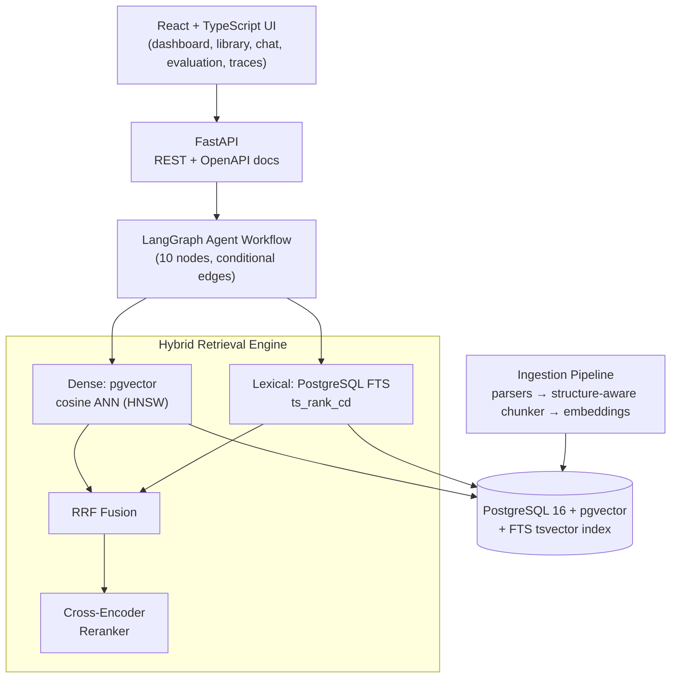

# Enterprise Knowledge Intelligence Platform

An **agentic Retrieval-Augmented Generation (RAG) platform** for enterprise document Q&A with
hybrid retrieval, cross-encoder reranking, citation-grounded answers, no-evidence refusal,
retrieval/generation evaluation, and per-query observability — built as a portfolio-grade,
production-oriented system (FastAPI + LangGraph + PostgreSQL/pgvector + React/TypeScript + Docker).

> Every metric in this repository comes from actual runs of the evaluation harness on the
> included synthetic corpus (see [docs/evaluation.md](docs/evaluation.md) for the raw numbers
> and their hardware context). Nothing is pre-baked.

## Results

10 synthetic policy documents, about 64 chunks, 19 questions. Retrieval figures are the published hybrid comparison. Generation figures are from [`data/evaluation/last_generation_run.json`](data/evaluation/last_generation_run.json): `qwen2.5:32b` through Ollama, LLM-as-judge, PostgreSQL 16 + pgvector.

| Metric | Result |
|---|---|
| Recall@5, hybrid + rerank | 0.790 |
| Precision@5, hybrid alone → hybrid + rerank | 0.209 → 0.383 |
| MRR / nDCG@5, hybrid + rerank | 0.790 / 0.790 |
| Faithfulness, all 19 questions | 0.8421 |
| Faithfulness, 16 answerable questions | 0.8125 |
| Answer relevancy, answerable questions | 4.5 / 5 |
| Citation correctness | 0.8947 |
| Refusals on the 3 out-of-corpus questions | 3/3 |

Recall@5 of 0.790 is the ceiling of this metric here: four questions have an empty relevant-document set. The earlier faithfulness figure of 0.368 is a previous `qwen2.5:3b` judge that scored correct refusals as unfaithful. It is not this score.

---

## Why this project exists

"Chat with a PDF" demos skip every hard part of production RAG: lexical+dense hybrid retrieval,
reranking, tenant isolation, hallucination refusal, citation integrity, evaluation and latency
observability. This project is a small but complete implementation of those concerns — designed
to be **interview-defensible**: every design choice is documented with its trade-offs in
[docs/design_decisions.md](docs/design_decisions.md).

## What it does

1. **Ingest** enterprise documents (PDF, DOCX, TXT, Markdown, HTML) with per-format parsers,
   structure-aware chunking (headings/sections/lists/tables, page boundaries for PDFs), local
   embeddings, and PostgreSQL full-text indexing.
2. **Retrieve** with a hybrid pipeline: pgvector cosine search ∥ PostgreSQL FTS (OR-expanded,
   cover-density ranked) → **Reciprocal Rank Fusion** → **cross-encoder reranking**.
3. **Answer** through a **LangGraph agent workflow** (10 explicit nodes, conditional edges):
   query analysis/rewriting, multi-query decomposition, retrieval, fusion, reranking, context
   validation with a relevance gate, grounded JSON generation, **citation validation**, and a
   final response builder that refuses to answer without sufficient evidence.
4. **Prove it works** with a built-in evaluation harness (Recall@5, Precision@5, MRR, nDCG@5;
   faithfulness / answer relevancy / citation correctness) that compares **dense vs lexical vs
   hybrid vs hybrid+rerank** on a 19-question enterprise-policy dataset.
5. **Observe everything**: every query persists a full trace — per-stage latencies, retrieved
   chunks with scores at each stage, rewritten queries, token usage and estimated cost.

## Architecture



Full detail: [docs/architecture.md](docs/architecture.md) · Pipeline: [docs/rag_pipeline.md](docs/rag_pipeline.md) · **Interactive workflow diagram** (Archify-generated, self-contained HTML): [docs/diagrams/rag-workflow.html](docs/diagrams/rag-workflow.html)

## Technology stack

| Layer | Choice |
|---|---|
| Backend | Python 3.11, FastAPI, Pydantic v2, SQLAlchemy 2, Alembic |
| Agent orchestration | LangGraph (`StateGraph`, typed state, conditional edges) |
| LLM | OpenAI (default) behind a provider abstraction; deterministic offline `extractive` provider |
| Embeddings | Sentence Transformers `all-MiniLM-L6-v2` (local) behind a provider abstraction |
| Reranker | Cross-encoder `ms-marco-MiniLM-L-6-v2` (local, configurable) |
| Database | PostgreSQL 16 + pgvector (HNSW cosine) + native FTS |
| Frontend | React 18, TypeScript, Vite, react-router (no heavyweight UI kit) |
| Infra | Docker, Docker Compose (postgres + backend + frontend) |
| Testing | pytest — 140 tests (unit / integration / security-isolation) |

## Quick start (Docker)

```bash
cp .env.example .env          # add EKIP_OPENAI_API_KEY=sk-... for full LLM quality
docker compose up --build
```

- UI: http://localhost:8080
- API + Swagger docs: http://localhost:8000/docs
- First start downloads the embedding/reranker models (~200 MB) and applies Alembic migrations
  automatically. Pick a demo identity on the login screen (two tenants are seeded to demonstrate
  isolation).

**No API key?** Set `EKIP_LLM_PROVIDER=extractive` — the system runs fully offline with a
deterministic extractive answerer (demonstrates the grounding/citation machinery; not LLM quality).

**Local model (measured path).** Ollama speaks the OpenAI API. The generation numbers above used:

```bash
export EKIP_LLM_PROVIDER=openai
export EKIP_OPENAI_BASE_URL=http://127.0.0.1:11434/v1
export EKIP_OPENAI_API_KEY=ollama-local
export EKIP_LLM_MODEL=qwen2.5:32b
export EKIP_LLM_TIMEOUT_SECONDS=180
export EKIP_VECTOR_BACKEND=pgvector
```

Do not point this at `api.openai.com` unless you intend to spend API credit. `ollama-local` is a placeholder, not a secret.

### Ingest the sample corpus & run evaluation

```bash
docker compose exec backend python ../scripts/ingest.py --tenant acme   # local venv: python scripts/ingest.py
python scripts/evaluate.py --tenant acme                                # retrieval metrics, 4 strategies
python scripts/evaluate.py --tenant acme --generation                   # + generation metrics
python scripts/benchmark.py --tenant acme                               # latency benchmark
```

(or use the UI: **Evaluation → Run evaluation**)

## Local development (without Docker)

Requirements: Python 3.11+, Node 20+, PostgreSQL (pgvector optional — see below).

```bash
# backend
cd backend
python -m venv .venv && . .venv/bin/activate        # Windows: .venv\Scripts\activate
pip install -r requirements.txt
# create the database, then point .env at it (see .env.example) and migrate:
python -m alembic upgrade head
uvicorn app.main:app --reload --port 8000

# frontend
cd ../frontend
npm install
npm run dev        # http://localhost:5173 (proxies /api to :8000)
```

**pgvector note:** `EKIP_VECTOR_BACKEND=pgvector` (default) requires the pgvector extension —
native in the Docker image. On a plain PostgreSQL install without the extension set
`EKIP_VECTOR_BACKEND=array`: the same pipeline runs with embeddings stored as `float8[]` and
exact cosine in Python (identical interface; see
[docs/design_decisions.md](docs/design_decisions.md#vector-backend-pgvector-vs-array-compatibility-mode)).

**Running tests:** integration tests need a reachable PostgreSQL (`ekip_test` database is
created/truncated automatically):

```bash
cd backend && python -m pytest            # 140 tests
```

## RAG pipeline (short version)

```
question ─▶ query_analyzer ─▶ (rewrite? decompose?) ─▶ dense ∥ lexical ─▶ RRF fusion
         ─▶ cross-encoder rerank ─▶ context validator ─▶ grounded generation (JSON)
         ─▶ citation validator ─▶ final response (answer + citations + confidence + refusal)
```

Conditional edges: clear queries skip rewriting; weak retrieval retries once with a reformulated
query; insufficient evidence short-circuits to a grounded refusal; invalid citations trigger one
bounded regeneration. Full description: [docs/rag_pipeline.md](docs/rag_pipeline.md).

## Citations

Citations are **constructed server-side from actually-retrieved chunks**. Document name, page,
section, chunk id and excerpt are rebuilt from the chunk rows, and a quote is kept only when
it is an exact span of that chunk. Invalid refs or quotes are dropped and trigger a single
bounded regeneration.

Example: `[1] leave_policy.md, section "Annual Leave Entitlement" — "Full-time employees are
entitled to 22 days of paid annual leave..."`

## Evaluation methodology (summary)

- 19-question synthetic enterprise-policy dataset: direct lookup, multi-hop, comparison,
  numerical, policy reasoning, negative/no-answer, ambiguous, cross-document.
- Retrieval: Recall@5, Precision@5, MRR, nDCG@5 per strategy (dense / lexical / hybrid /
  hybrid+rerank), relevance = retrieved document ∈ expected documents.
- Generation: faithfulness + answer relevancy (LLM-as-judge when a generative provider is
  configured; deterministic heuristics otherwise — always labelled), citation correctness
  (deterministic rules), refusal behaviour on negative questions.
- Latency benchmarks per stage, p50/p95.

Actual measured results on the sample corpus are in
[docs/evaluation.md](docs/evaluation.md). Reranking roughly doubles Precision@5 over hybrid
alone on this dataset (0.209 → 0.383). The current generation run is local `qwen2.5:32b`
via Ollama (faithfulness 0.8125 on the 16 answerable questions). An earlier `qwen2.5:3b`
judge run and a containerized Docker/pgvector run are recorded separately and are not
interchangeable with the 32B numbers.

## Environment variables

All configuration is environment-driven (`EKIP_` prefix) and centralised in
`app/core/config.py`. See [.env.example](.env.example) for the complete annotated list —
providers, models, dimensions, chunking, retrieval Ks, RRF constant, relevance threshold,
upload limits, and LLM pricing for cost estimation. No secrets in code; no key ⇒ the app starts
and `/api/health` reports exactly what to set.

## API overview

| Method | Path | Purpose |
|---|---|---|
| GET | `/api/health` | DB + provider configuration status |
| GET | `/api/auth/demo-users` | seeded demo identities |
| POST | `/api/documents/upload` | upload + full ingestion (201; failed ingestion reported in body) |
| GET/DELETE | `/api/documents[/{id}]` | library (tenant-scoped) |
| GET | `/api/documents/{id}/chunks` | chunks with page/section metadata |
| POST | `/api/query` | full agentic RAG query (answer, citations, stages, tokens, cost) |
| GET | `/api/conversations[/{id}]` | history for follow-up queries |
| POST | `/api/evaluation/run` | run retrieval (+generation) evaluation |
| GET | `/api/evaluation/runs[/{id}]` | metrics + per-question detail |
| GET | `/api/traces[/{id}]` | observability traces |
| GET | `/api/metrics/summary` | dashboard counters |

Auth: lightweight `X-API-Key` header (demo identities seeded; see docs/design_decisions.md for
the production upgrade path). Interactive docs at `/docs` (OpenAPI).

## Example queries

- "How many days of paid annual leave do employees get?" → grounded answer citing `leave_policy.md`
- "What is the CEO's favorite color?" → **grounded refusal** ("couldn't find sufficient evidence…")
- "What about the previous policy?" (in a conversation) → rewritten to a self-contained query,
  retrieval runs again — history never substitutes for evidence
- "How many remote days per week are allowed and what home office support is provided?" →
  multi-hop across `employee_handbook.md` + `remote_work_policy.md`
- The handbook (18 days) vs leave policy (22 days) PTO conflict is a designed cross-document
  conflict case for the conflicting-evidence behaviour

## Known limitations

Honest and documented (details in docs/):

- **LLM-as-judge evaluation is imperfect**; heuristic mode (offline) measures keyword coverage,
  not semantic quality. On the 32B run, three answerable questions were still weak: one
  refusal even though the 401(k) match was in the retrieved text, and two answers that were
  right and then added one extra claim.
- "What about the previous one?" has no expected document. Asked with no conversation history,
  the model refuses. That is not a retrieval miss.
- The relevance gate (`min_relevance_score`) and the conflict heuristic are **documented
  heuristics**, not calibrated probabilities.
- Lexical retrieval uses `ts_rank_cd` (TF-style ranking) — not exact BM25 (no IDF in PostgreSQL
  core); OR-expansion trades phrase precision for recall.
- Array vector backend ranks in Python (exact but O(n)) — fine at portfolio scale, not
  production scale; production uses pgvector ANN.
- Lightweight API-key auth (no OAuth/OIDC, no rate limiting, no horizontal scaling of the model
  cache); single-process model singletons.
- No incremental re-indexing or document dedup; re-uploads create duplicate documents.

## Future improvements

- True BM25 via ParadeDB/pg_search or OpenSearch; learned sparse retrieval (SPLADE)
- Streaming responses (SSE) and answer diffing on regeneration
- Fine-tuned reranker on enterprise queries; A/B harness for chunking strategies
- OIDC auth with token-scoped tenants; per-tenant model routing
- Continuous evaluation in CI with regression gates; RAGAS-style dataset versioning

## Repository layout

```
enterprise-knowledge-platform/
├── backend/               FastAPI app (api/ core/ db/ models/ schemas/ services/
│                          ingestion/ embeddings/ retrieval/ llm/ agents/ evaluation/)
│   ├── alembic/           migrations (pgvector-aware, single source of truth for schema)
│   └── tests/             unit + integration + security (140 tests)
├── frontend/              React + TypeScript (Vite): dashboard, documents, chat, evaluation, traces
├── data/
│   ├── sample_documents/  10 synthetic enterprise documents (md/txt/html/docx/pdf)
│   └── evaluation/        19 questions plus last_generation_run.json (qwen2.5:32b)
├── docs/                  architecture, rag_pipeline, evaluation, api, design_decisions
├── scripts/               ingest.py, evaluate.py, benchmark.py, run_llm_eval.py, generate_sample_docs.py
├── docker-compose.yml     postgres (pgvector) + backend + frontend
└── .env.example           complete annotated configuration
```

## License

MIT — see [LICENSE](LICENSE). All sample documents are synthetic; no confidential or
copyrighted corporate content is included.
