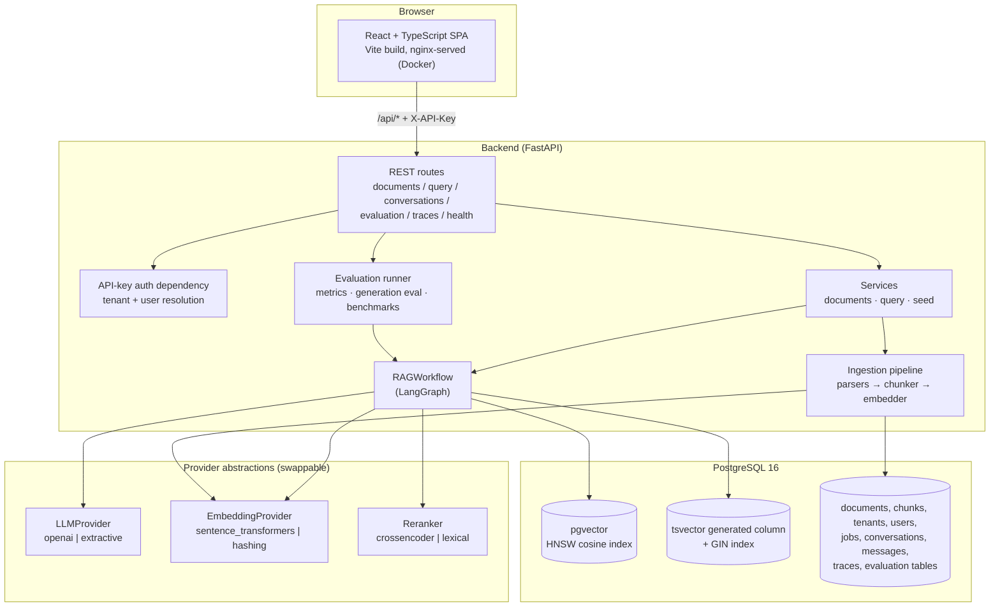
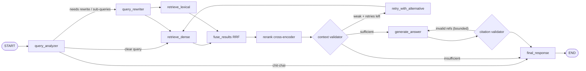

# Architecture

## System overview



## Data model

```
tenants 1───* users
  │            │
  └──* documents 1───* document_chunks (embedding, tsv, page, section)
        │    │
        │    └──* ingestion_jobs
        └──* conversations 1───* messages ─── query_traces
                                    │
tenants ─────────────────────────────┴── * evaluation_runs
evaluation_questions (global seed)
```

Key points:

- `document_chunks.tenant_id` is **denormalised** — every retrieval query filters on it, making
  cross-tenant leakage structurally impossible at the SQL level (asserted by security tests).
- `document_chunks.tsv` is a **stored generated column** maintained by PostgreSQL
  (`to_tsvector('english', section || text)`), so lexical indexing cannot drift from content.
- UUIDs everywhere, foreign keys with explicit cascade behaviour, composite indexes on
  `(tenant_id, …)` access patterns.
- One Alembic migration creates the full schema from empty (including `CREATE EXTENSION
  vector` and the HNSW index in pgvector mode); the ORM and migration share the embedding
  column-type helper, so they cannot diverge.

## Ingestion pipeline

```
Upload ─▶ validation (extension allowlist + magic bytes + size + safe filename)
       ─▶ parser per type ─▶ ParsedBlocks (text, kind, page?, section?)
       ─▶ structure-aware chunker ─▶ Chunk(text, page, section, tokens, metadata)
       ─▶ embedding provider (batched)
       ─▶ INSERT chunks (+embedding)  [tsvector generated automatically]
       ─▶ document + ingestion_job status/timing
```

Failure handling: unsupported types are rejected **before any DB write** (HTTP 415); parse
failures (corrupt PDF, empty document) are *recorded* as failed documents/jobs and returned —
never silently dropped, never a stack trace.

## Agentic workflow (LangGraph)



State is a typed `RAGState` (TypedDict). Parallel retrieval nodes write disjoint keys
(`dense_results` / `lexical_results`) and append to an additive `stages` reducer — no write
conflicts, full per-stage latency accounting.

## Frontend

Vite + React 18 + TypeScript, react-router, hand-rolled CSS (no UI framework — keeps the
bundle small and the design intentional). Pages: Dashboard, Documents (upload + library +
detail/chunks), Knowledge Query (chat with citations, stage pills, confidence, tokens, cost,
trace links), Evaluation (strategy comparison + per-question detail), Traces (list + full
pipeline inspection). Identity: demo user picker storing an `X-API-Key` in localStorage.

## Docker topology

```
docker compose up
  frontend (nginx :8080)  ──/api proxy──▶ backend (:8000)
  backend ──migrations at start (entrypoint)──▶ postgres (pgvector/pgvector:pg16, healthchecked)
  volume: pgdata (persistent)
```
